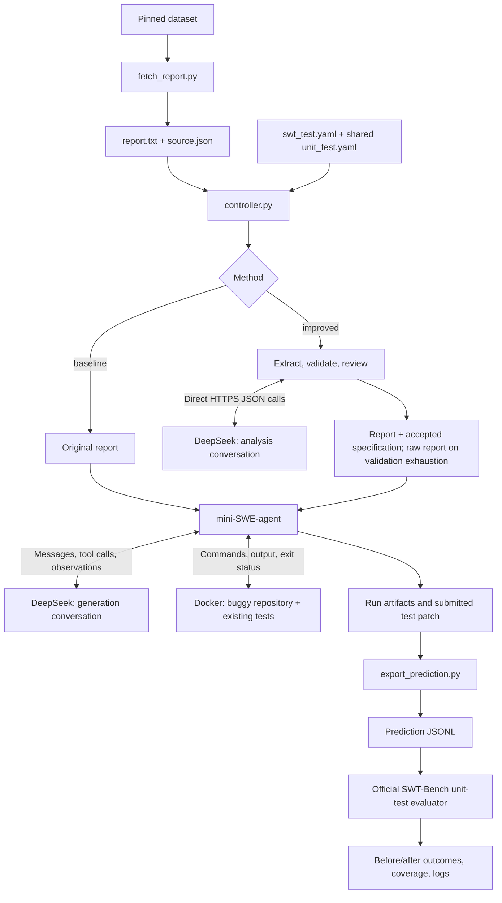
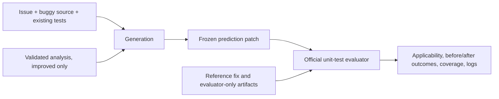

# TRACE workflow walkthrough: how the scripts, mini-SWE-agent, and DeepSeek communicate

This guide describes the current four root Python files and the shared native
unit-test workflow. It distinguishes implemented checks from proposed improvements.
Historical pilot measurements belong in the experiment reports, not this guide.

## 1. The complete picture

TRACE asks whether evidence-grounded analysis of a bug report improves regression
test generation with a fixed DeepSeek-Flash agent. The hypothesis is that explicitly
identifying the trigger and expected behavior helps the generator select a relevant
assertion. Analysis adds runtime and model calls, so benefits must be measured.



The two DeepSeek boxes are separate conversations. The controller manages the
analysis conversation. mini-SWE-agent manages the generation conversation. Accepted
analysis is transferred as text in the task, not as shared conversation memory.

DeepSeek does not directly open local files or run a terminal. Python reads the
report. Later, DeepSeek proposes shell commands and mini-SWE-agent executes them
inside Docker, then sends the observations back to the model.

## 2. What each component owns

| Component | Responsibility |
| --- | --- |
| Our scripts | Prepare inputs, optionally analyze reports, launch generation, save records, export predictions |
| DeepSeek | Interpret supplied text and observations; propose analysis, test code, and shell actions |
| mini-SWE-agent | Maintain generation messages, call its model adapter, execute requested tools, handle completion |
| Docker environment | Provide the buggy checkout, dependencies, fixtures, and native test runner |
| Official evaluator | Measure submitted tests against buggy and reference-fixed code |
| Researcher | Audit evidence and compare both methods over all assigned instances |

## 3. `fetch_report.py`: prepare the original issue

`main()` parses the dataset name, required dataset revision, split, instance ID,
and a new output directory. It calls `datasets.load_dataset()` with that revision,
requires exactly one matching instance, and writes:

- `report.txt`: the original `problem_statement`.
- `source.json`: instance ID, repository, `base_commit`, dataset name, revision, split.

It refuses to reuse an output directory. The dataset revision pins the dataset;
`base_commit` identifies the instance's buggy source checkout. They are different
commits. This script does not generate tests or call DeepSeek.

The datasets library loads complete rows and may cache the download. This script
only explicitly exports the issue and listed metadata, not reference fixes or
reference test patches. Dataset caches and evaluator-only data must not become
inputs to the generator.

`controller.py` reads `report.txt`, not `source.json`; it does not automatically
verify that the supplied Docker image matches the saved `base_commit`. The surrounding
experiment procedure must establish that match.

## 4. How the YAML files control generation

`baseline/swt_test.yaml` is a preserved configuration, not a test or dataset. It defines:

- System/task instructions and observation/error message templates.
- Agent step limit 100 and cost limit $0.50.
- Docker execution, `/testbed` working directory, and 60-second command timeout.
- Shell environment, including `BASH_ENV=/root/.bashrc` for image initialization.
- Generation model `deepseek/deepseek-v4-flash` and adapter options.

The original instructions create a standalone `/testbed/reproduce.py`. For the
current experiment, `--test-format unit_test` overlays `profiles/unit_test.yaml`
in memory. That profile replaces the task instructions with native-test requirements
and sets the shell to `bash -o pipefail -c`. Both methods receive the same overlay.
The original baseline file stays unchanged on disk and is SHA-256 checked before runs.

| Setting | Baseline arm | Improved arm |
| --- | --- | --- |
| Task input | Original issue | Original issue plus accepted analysis, or flagged fallback |
| Unit-test profile | Same shared profile | Same shared profile |
| Generation model and agent limits | Same settings | Same settings |
| Buggy image and issue snapshot | Matched | Matched |
| Preprocessing model calls | None | Extraction, review, bounded revisions |

Without the unit-test flag, the controller defaults to the older reproduction-script
format. Script-format runs are not accepted by the unit-test prediction exporter.

## 5. Baseline: from report to test patch

### Preparation in `controller.py`

`main()` reads the report and baseline configuration, verifies the baseline hash,
computes the optional profile hash, rejects empty report text, and requires an image
when `--launch` is requested. It creates a fresh output directory and copies the
report there. Existing output directories cause `FileExistsError` rather than being
overwritten.

With `--mode baseline`, it skips `extract()` and writes the original report directly
to `task.txt`. No analysis API calls are made by the controller. The manifest's
`attempts=0` and `validated=false` mean preprocessing was skipped; they do not assess
test quality. Without `--launch`, the run ends at preparation.

### Launching mini-SWE-agent

`launch()` requires installed `mini-swe-agent==2.4.6`. It loads the effective configuration,
saves it, and uses the package factories:

```text
get_environment(cfg['environment']) -> Docker environment adapter
get_model(config=cfg['model'])      -> generation model adapter
get_agent(model, env, cfg['agent']) -> agent
agent.run(task)                    -> generation conversation and final result
```

The agent/environment layer manages Docker execution using the chosen image. The
controller does not run Django on the Windows host. Repository commands execute
against `/testbed` inside the container.

```mermaid
sequenceDiagram
    actor U as Researcher
    participant C as controller.py
    participant A as mini-SWE-agent
    participant M as DeepSeek generation model
    participant D as Docker /testbed
    U->>C: Report, baseline mode, image, unit-test format
    C->>C: Verify inputs; save report and task
    C->>A: Create environment/model/agent; run(task)
    A->>M: System instructions + rendered task
    loop Until submission or stopping condition
        M-->>A: Explanation and bash tool call(s)
        A->>D: Execute requested commands
        D-->>A: Output, return code, execution error if any
        A->>M: Append command observations to conversation
    end
    A-->>C: Exit status and submitted text
    C->>C: Save result, patch, trajectory, manifest; clean up
```

### Reading source and generating the test

DeepSeek chooses commands to locate relevant code, inspect existing tests, select
fixtures, edit tests, and invoke the native runner. Those search/edit decisions are
not hard-coded into our controller. mini-SWE-agent executes the commands and preserves
the conversation so the model can respond to their results.

For `django__django-11163`, a sensible sequence is to locate `model_to_dict`, read
`ModelToDictTests` and its existing models, then add a test asserting that
`model_to_dict(item, fields=[])` returns `{}`. An existing fixture must be selected
from the repository rather than invented from the issue alone.

`tests/model_forms/tests.py` refers to Django's checkout inside the container, not
a Python file in TRACE. The submitted diff describes edits relative to that checkout.
Saving the diff does not extract the whole Django source tree to the host.

### Running and interpreting the test

The model requests a native test command and receives its output and return code.
The observation template shortens output longer than 10,000 characters to its first
and last 5,000 characters, with an omitted-character count. Important middle output
may require a more focused follow-up command.

A failing command alone is insufficient. An assertion showing the reported wrong
behavior is useful evidence; a typo, missing import, bad fixture, or setup failure
is not reproduction. The shared profile tells the agent to inspect that distinction.

`pipefail` preserves a failed runner's status through `tail` or `tee`. The profile
also instructs immediate status capture, for example:

```bash
python tests/runtests.py model_forms --settings=test_sqlite 2>&1 | tail -80
status=$?; echo "test runner pipeline exit status: $status"; exit "$status"
```

This is a Django example, not a universal test command. Follow-up work must run in
separate tool calls so a later successful command cannot hide runner failure.

### Submission

The profile asks for a unified diff containing only native test changes, inspected
before submission. New files need `git add -N` to appear in the diff. The final
submission command is:

```bash
echo COMPLETE_TASK_AND_SUBMIT_FINAL_OUTPUT && cat /tmp/trace-unit-test.patch
```

mini-SWE-agent handles that completion convention and returns a result. The controller
saves `agent_result.json`, a nonempty submission as `submission.patch`, and the
serialized conversation as `agent.traj.json` when an agent exists. Cleanup runs in
`finally` blocks, including after errors.

`Submitted` is an agent outcome, not official benchmark success. The patch has not
thereby been proven applicable or shown to pass after the reference fix.

## 6. Improved: the added analysis conversation

The improved method adds preprocessing before the same generation loop. Analysis
has no shell tools or repository observations: it receives the original report.

```mermaid
sequenceDiagram
    participant C as controller.py / extract
    participant M as DeepSeek analysis API
    participant V as Python validation
    participant A as mini-SWE-agent
    C->>C: Require analysis API key
    loop Initial extraction plus at most two revisions by default
        C->>M: Extraction instructions + report + previous errors
        M-->>C: Candidate specification JSON
        C->>V: Check fields, types, exact report quotes
        alt Deterministic checks pass
            C->>M: Separate review request: report + candidate
            M-->>C: Valid flag, unsupported claims, contradictions, omissions
            C->>V: Check review structure and acceptance
        end
        C->>C: Save available records; stop on acceptance or retry with errors
    end
    alt Accepted analysis
        C->>A: Original report + accepted specification
    else Validation exhausted
        C->>A: Original report only; record fallback
    end
    Note over C,A: Operational errors stop rather than trigger this fallback
```

### `ask()`: one controller-managed model call

`ask(model, system, payload, out, label)` reads `DEEPSEEK_API_KEY`, builds a system
message plus a user message containing serialized JSON, requests JSON output with
up to 4,096 tokens, and saves the request body. It sends an HTTPS POST to
`https://api.deepseek.com/chat/completions` with a bearer authorization header and
180-second timeout.

It saves the returned response and timing/usage metrics, requires
`finish_reason == 'stop'`, and parses the message content as JSON. The saved request
body does not contain the API authorization header. `cost_usd` is currently null;
this helper records usage but does not calculate dollar cost.

These calls are outside mini-SWE-agent's conversation and its $0.50 cost limit.
The extraction default is `deepseek-flash`, whereas the generation adapter uses
`deepseek/deepseek-v4-flash`. These naming strings alone do not prove identical
backend versions: record and verify the intended fixed implementation. Changing
`--extract-model` does not change the agent's generation model.

### `extract()`: orchestrating the analysis loop

`extract()` calls `ask()` to request exactly five fields:

| Field | Information sought |
| --- | --- |
| `target_function` | Named function or behavior |
| `triggering_input` | Input/condition exposing the bug |
| `observed_behavior` | Reported buggy result |
| `expected_behavior` | Intended result |
| `suggested_assertion` | Check explicitly supported by the issue |

Each entry contains exactly `value` and `evidence`. Known values need nonempty
strings and a verbatim contiguous report quote. Unknown values and evidence must
both be null. The prompt prohibits fabricated details and runnable identifiers.
The suggested assertion is analysis, not necessarily executable code.

For the Django example, the report can support an empty field list expecting an
empty dictionary without identifying a valid test fixture. The agent chooses the
fixture later by reading the repository.

### `validate()`: Python checks the candidate

Python checks the exact five top-level keys, exact entry keys, value types,
null consistency, nonempty evidence, and that each evidence string occurs in the
original report. It also rejects a specification with every value unknown.
It returns errors or an empty list.

These checks establish structure and quoted grounding. A genuine quote can still
be attached to a wrong interpretation, so they do not establish logical support.

### Semantic review and `semantic_errors()`

After deterministic checks pass, another `ask()` call sends the original report
and candidate to DeepSeek with review instructions. It asks about unsupported
claims, contradictions, assumptions, omissions, and information wrongly marked unknown.
This is a fresh two-message request, not shared memory with extraction.

Acceptance requires this exact review shape, a boolean true, and empty arrays:

```json
{"valid": true, "unsupported_fields": [], "contradictions": [], "missing_information": []}
```

`semantic_errors()` checks schema/types and the acceptance decision. DeepSeek
supplies the substantive judgment. A separate same-model review can repeat the
extractor's error; it is not independent ground truth.

### Revisions and fallback

The default two revisions permit three extraction attempts. Each can require one
review, for up to six analysis calls; structurally invalid candidates skip review.
Errors become feedback for the next extraction alongside the original report.
The prior candidate is not explicitly passed as a separate next-attempt field.

Acceptance writes `bug_spec.json`. The controller appends it to the original report
in `task.txt` as supporting analysis and launches the ordinary generation loop.
The original report is retained in full.

Validation exhaustion returns no specification: the raw report is sent and the
manifest records `fallback=true`. This remains an improved-arm attempt with fallback,
not an excluded case or a replacement baseline observation.

Missing credentials raise `ConfigurationError` before extraction/launch. HTTP 401,
network failures, and other operational exceptions also fail rather than silently
triggering fallback. Extraction catches content-processing `ValueError`, `KeyError`,
`IndexError`, and `TypeError` as validation errors eligible for revision.

### Generation after analysis

The launcher, agent, Docker image, native-test profile, test execution feedback,
and submission process are the same as baseline. Only the task now includes accepted
supporting analysis. The controller does not call extraction again after a failed
test. Repairs within generation are choices in the ordinary agent loop, not a separate
controller-managed execution-feedback repair stage.

## 7. `controller.py` function reference

| Function/class | Purpose |
| --- | --- |
| `ConfigurationError` | Identify a configuration failure such as missing analysis credentials |
| `require_deepseek_key()` | Strip and check the environment key; does not authenticate it with the provider |
| `digest()` | SHA-256 provenance/configuration checks |
| `save()` | Exclusive-create JSON writer; refuses overwrites |
| `validate()` | Deterministic specification schema and quote checks |
| `semantic_errors()` | Validate semantic review and determine acceptance |
| `ask()` | One direct, recorded analysis API request |
| `extract()` | Bounded extraction/validation/review loop |
| `unit_test_profile()` | Locate shared profile relative to this script |
| `load_agent_config()` | Load baseline, overlay profile in memory, require Docker, insert image |
| `launch()` | Construct package objects, run agent, save outputs, clean up |
| `main()` | Parse arguments, prepare run, choose method, construct task, optionally launch, record status |

The manifest records instance, method, hashes, image string, Python version,
preprocessing attempts, validation/fallback, elapsed time, status, and whether baseline
bytes remained unchanged. A supplied image tag is not automatically an immutable
image digest. Controller elapsed time includes preprocessing and launch/cleanup when
requested, after initial preparation; it is not evaluation time.

`prepared` means launch was not requested. `agent_finished` means launch returned.
`validated=true` concerns bug analysis, not generated test quality. Exceptions in
the protected execution section record failed status and error type; configuration
errors add stage/message details. Earlier failures such as a bad hash or existing
output directory may occur before manifest creation.

## 8. Reading the run artifacts

| File | What it tells you |
| --- | --- |
| `report.txt` | Original issue supplied for the run |
| `task.txt` | Exact task handed to generation, including analysis if accepted |
| `manifest.json` | Settings, provenance, status, timing |
| `extract-N.request.json` / `.response.json` / `.metrics.json` | Controller-to-DeepSeek extraction communication and usage |
| `candidate-N.json` | Parsed candidate analysis |
| `review-N.request.json` / `.response.json` / `.metrics.json` | Review communication and usage |
| `validation-N.json` | Errors or acceptance for that attempt |
| `bug_spec.json` | Accepted analysis only |
| `effective_config.json` | Resolved agent configuration |
| `agent.traj.json` | Generation messages, commands, observations, package metadata |
| `agent_result.json` | Agent termination status and submitted text |
| `submission.patch` | Saved nonempty submission |

Baseline runs lack analysis files. Prepare-only runs lack agent files. Failures may
leave partial artifacts. Attempt numbers start at zero. To audit communication,
read requests/responses, task, and trajectory; compare each runner command to its
observed output/status. Use the final patch rather than an intermediate edit.

## 9. `export_prediction.py`: package the final result

`export_prediction(run, out, label=None)` reads the manifest and requires native
`unit_test` format. It reads `agent_result.json` when available, using `submission`
only when `exit_status == 'Submitted'`. Otherwise it emits an empty patch so failure
can remain represented.

It writes one JSONL row with `instance_id`, `model_patch`, and `model_name_or_path`.
Default labels are `trace-baseline-unit-test` and `trace-improved-unit-test`; an
optional label overrides them. It creates output parents and refuses overwrites.
The prediction text comes from the result JSON, not from `submission.patch`.

This script does not call DeepSeek, run Docker/tests, apply a patch, or determine
success. Missing run manifests still need full assigned-instance bookkeeping outside
this function; it does not enumerate the assignment itself.

## 10. Official evaluation and information boundaries



Evaluation is separate from these four scripts. Use the installed official harness
and the documented pinned evaluation procedure. It determines whether tests meet
the official success criterion, including failing before the reference fix and
passing afterward. Reference fixes/tests and evaluator-only outcomes must not be
fed back into generation or repair.

Retain missing predictions, generation failures, and method-caused timeouts in the
assigned denominator. Log infrastructure failures separately and retry unchanged
predictions after recovery with unchanged settings. For coverage, identify the exact
harness field, units, aggregation, and available-instance count; unavailable is N/A.
Do not infer benchmark success from a zero harness process exit code alone.

## 11. What quality checks exist today?

| Question | Current check | Limitation |
| --- | --- | --- |
| Does analysis quote the report? | Python schema/substring checks | Quote may not entail the claim |
| Is analysis logically supported? | Separate DeepSeek review | Same-model judgment may be wrong |
| Does the generated test have meaningful assertions? | Profile instructions and human patch review | No controller assertion detector |
| Did the runner fail? | Command observation with pipefail/status instructions | Audit actual command and evidence |
| Did it fail for the issue rather than a typo? | Agent interpretation plus researcher traceback review | No deterministic controller failure classifier |
| Does it pass after the fix? | Official evaluation | Not available during generation |
| Does the patch modify tests only? | Instructions and patch review | No separate controller path-policy gate |

A literal `assert` is not sufficient evidence of quality. Native checks may use
`self.assertEqual`, `pytest.raises`, or framework equivalents. A future quality stage
could inspect meaningful checks and classify failures without weakening assertions
or accessing fixes. That is an additional workflow change to evaluate separately.

## 12. `test_controller.py`: test TRACE itself

This unittest module imports the controller and exporter, uses temporary directories,
and mocks network/agent execution. Its 11 tests cover grounding/schema, review
rejection/types, shared profile and exit-status instructions, patch preservation,
export no-overwrite, failed predictions, script rejection, revision/acceptance,
validation exhaustion, baseline preparation, missing-key behavior, launcher settings,
submission collection, baseline preservation, and cleanup.

```bash
python -m unittest -v
```

These tests do not require live API calls or a running Docker daemon. They do not
prove provider authentication, actual container execution, or benchmark reproduction.
See `OFFLINE_TESTS.md` for collaborator dependency/import checks and the pilot guides
for live workflows.

## 13. Matched-run example

Run from the repository root in the activated environment. In WSL the original clone
is `/workspace/swt-bench-work`; teammates use their own clone path.
Set `IMAGE` to the verified image for this exact issue and configure provider
credentials in the terminal without committing keys.

```bash
python controller.py \
  --mode baseline --test-format unit_test \
  --report data/django__django-11163/report.txt \
  --instance django__django-11163 --image "$IMAGE" --launch \
  --out runs/django-11163-baseline-new

python controller.py \
  --mode improved --test-format unit_test \
  --report data/django__django-11163/report.txt \
  --instance django__django-11163 --image "$IMAGE" --launch \
  --out runs/django-11163-improved-new

python export_prediction.py \
  --run runs/django-11163-baseline-new \
  --out predictions/django-11163-baseline-new.jsonl

python export_prediction.py \
  --run runs/django-11163-improved-new \
  --out predictions/django-11163-improved-new.jsonl
```

Use fresh names. Baseline generation still requires credentials accepted by the
agent's model adapter even though it skips the controller's analysis-key precheck.
Export only packages predictions; official evaluation follows separately.

For a fair comparison, match snapshots, images, model version, shared profile, and
limits. Include improved preprocessing in cost/runtime. Preserve failures and all
outputs. The threat of same-model review errors and variability across repeated
model runs limits conclusions from isolated examples; examine the full assignment.

## 14. Suggested reading order

Read `fetch_report.py`, then `controller.py` beginning with `main()` and following
`extract()` and `launch()`, then both YAML files, the exporter, and the offline tests.
For a run, follow provenance -> report -> manifest -> analysis -> task -> effective
configuration -> trajectory -> result/patch -> official evaluation. This separates
what was supplied, inferred, executed, submitted, and measured.
